<!-- Hello There :D -->

# funnyboy_roks

Hello, I'm funnyboy_roks, or fbr! I have been programming for almost
a decade, building various applications and tools.

I build a lot of random bits of software, including libraries, CLI
tools, websites, programming languages, Minecraft plugins, and so much
more.  The vast majority of software that I build is open source and
can be seen in my
[repositories](https://github.com/funnyboy-roks?tab=repositories) or on
[Codeberg].

I primarily do low-level programming in languages like Rust or C,
writing software that interacts with the operating system and some
embedded applications.  I have also been known to write some Java and
make the occasional webbed-site.

## Languages

I thoroughly enjoy programming languages, both in theory and in
practice.  I've played around with many languages (and even built some
of my own), but I use just a handful for the majority of my projects.

Most-used languages: [Rust], [C], [JavaScript]/[TypeScript], [Java]

[Rust]:       https://github.com/funnyboy-roks?tab=repositories&language=rust
[C]:          https://github.com/funnyboy-roks?tab=repositories&language=c
[JavaScript]: https://github.com/funnyboy-roks?tab=repositories&language=javascript
[TypeScript]: https://github.com/funnyboy-roks?tab=repositories&language=typescript
[Java]:       https://github.com/funnyboy-roks?tab=repositories&language=java

## Links

- [Website](https://fbr.dev)
- [Codeberg]
- [Modrinth](https://modrinth.com/user/funnyboy-roks)

## Contact

If you need support about a project or wish to report a bug, please open
an issue on the project's repository.

If you need assistance with one of my Minecraft plugins, please join my
[Discord server](https://fbr.dev/discord).

Other senders can send me an email at
[`fbr@fbr.dev`](mailto:fbr@fbr.dev).

[Codeberg]: https://codeberg.org/fbr
